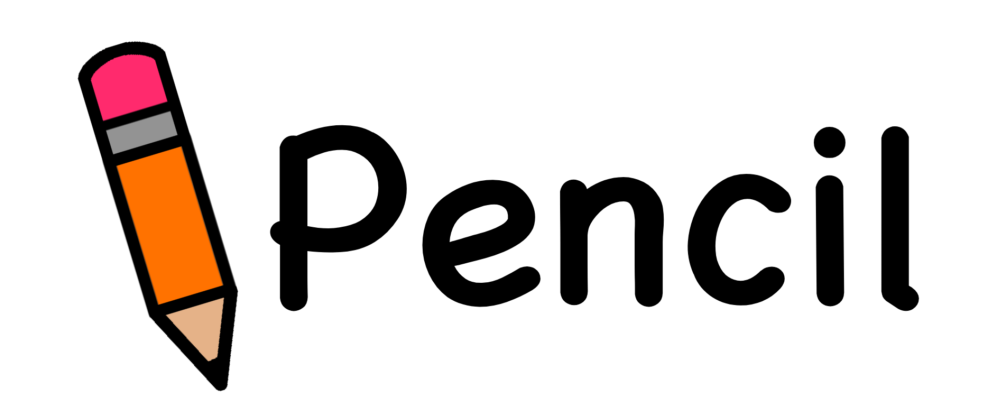

<p align="center">
  
</p>

<h1 align="center">Pencil v0.0.7 beta</h1>

<p align="center">A CPU-based ray tracer written from scratch in C++.</p>

---

Pencil renders 3D scenes without relying on a graphics API or an existing
rendering engine. Everything from ray generation to intersection testing
and lighting is implemented by Pencil itself.

## Quick start

```bash
# Build (Linux native):
g++ -O2 -std=c++17 src/pencil.cpp src/camera.cpp src/stb_impl.cpp -o pencil -lpthread

# Build (Windows cross-compile with MinGW):
x86_64-w64-mingw32-g++ -O2 -std=c++17 -static src/pencil.cpp src/camera.cpp src/stb_impl.cpp -o pencil.exe -lws2_32 -pthread

# Run:
./pencil examples/three_spheres.pecl
# -> writes three_spheres.png

# Built-in demo scene:
./pencil --demo
# -> writes pencil_demo.png

# Override render parameters:
./pencil examples/three_spheres.pecl big.png --width 1280 --height 960 --samples 8

# Benchmark BVH vs no-BVH:
./pencil --benchmark examples/bvh_stress.pecl

# Multithreaded (auto-detects cores, or override):
./pencil --threads 8 examples/three_spheres.pecl
```

## Output format

Pencil writes 24-bit binary PPM (P6). Any image viewer, GIMP, ImageMagick, or
`feh` should open it directly. To convert to PNG:

```bash
magick out.ppm out.png
```

## The `.pecl` scene format (v2)

`.pecl` v2 is a deliberately simple, block-based scene format. Whitespace is
insignificant. Lines starting with `#` are comments. Everything else is either
a top-level scalar (`bg:`/`amb:`) or a block (`name { ... }`).

### The whole grammar at a glance

```
# Top-level scalars
bg:  <r, g, b>          # background color (0-100)
amb: <r, g, b>          # ambient light   (0-100)

# Camera
cmra {
  pos:  <x, y, z>        # eye position
  aim:  <x, y, z>        # look-at point
  up:   <x, y, z>        # up direction
  fov:  60               # vertical FOV in degrees
}

# Current material (subsequent primitives inherit these)
mat {
  clr: <r, g, b>        # albedo color       (0-100)
  rfl: 0..100            # reflectivity       (0-100; 100 = perfect mirror)
  ior: 1.5               # index of refraction (makes material a dielectric)
  spc: 0..100            # Phong specular     (0-100)
  shn: 32                # Phong exponent     (any positive number)
  emt: <r, g, b>        # emission color     (0-100)
  fuz: 0..100            # metal fuzz         (0-100)
  typ: diffuse|metal|glass|emissive
}

# Primitives (all inherit current material, can override inline)
sphere { pos: <x,y,z>, rad: r }
cube   { pos: <x,y,z>, size: half_extent }
plane  { pos: <x,y,z>, nrm: <nx,ny,nz> }
tri    { v0: <x,y,z>, v1: <x,y,z>, v2: <x,y,z> }
quad   { a: <x,y,z>, b: <x,y,z>, c: <x,y,z>, d: <x,y,z> }
cyl    { pos: <x,y,z>, ax: <ax,ay,az>, rad: r, h: total_length }
cone   { apex: <x,y,z>, ax: <ax,ay,az>, rad: base_r, h: total_height }
mesh   { file: "path/to/model.obj", scale: 2.0, pos: <x,y,z> }

# Implicit surface via math expression, flexible!
surf {
  func { x*x + y*y + z*z - 1 }
  min:  <-2, -2, -2>
  max:  <2, 2, 2>
  steps: 200       # optional marching steps (default 200)
  step:  0.02       # optional step size       (default = bbox/200)
}

# Lights
light {
  type: point|directional
  pos:  <x, y, z>     # for point
  dir:  <x, y, z>     # for directional
  clr:  <r, g, b>    # intensity (0-100)
}

# Render settings
render {
  size: 640 480
  spp: 4              # samples per pixel (n*n jittered)
  depth: 8            # max reflection/refraction bounces
}
```

### Values

| Kind        | Syntax                    | Notes                              |
|-------------|---------------------------|------------------------------------|
| vector      | `<x, y, z>`              | 3 floats, comma-separated         |
| color       | `<r, g, b>`              | 3 floats in 0-100 (divided by 100)|
| scalar      | `42`, `-1.5`, `0.3`       | plain number                       |
| size pair   | `640 480`                 | two numbers on one line            |
| identifier  | `point`, `diffuse`        | bareword                           |
| expression  | `func { x*x + y*y - 1 }` | math expression in braces         |

### Material shortcuts

Material keys are deliberately short:

| key   | full name      | range / type        |
|-------|----------------|---------------------|
| `clr` | color          | `<r,g,b>` 0-100     |
| `rfl` | reflectivity   | 0-100               |
| `rfr` | refraction     | 0-100 (any >0 → glass) |
| `ior` | index of refr. | float (e.g. 1.5)    |
| `spc` | specular       | 0-100               |
| `shn` | shininess      | any positive number |
| `emt` | emission       | `<r,g,b>` 0-100     |
| `fuz` | metal fuzz     | 0-100               |
| `typ` | material type  | `diffuse`/`metal`/`glass`/`emissive` |

### Inline material overrides

Any primitive can override material properties inline. The override only
affects that one primitive:

```
mat { clr: <50, 50, 50>, spc: 10, shn: 32 }   # default

sphere { pos: <0, 0, 0>, rad: 1, clr: <100, 0, 0> }   # red sphere
sphere { pos: <2, 0, 0>, rad: 1, rfl: 100 }            # mirror sphere
sphere { pos: <4, 0, 0>, rad: 1, ior: 1.5 }            # glass sphere
```

### Implicit surfaces (`surf`)

The `surf` block lets you render any surface defined by `f(x, y, z) = 0`.
Pencil ray-marches the function inside the bounding box and bisects when it
finds a sign change.

Supported expression operators: `+ - * / ^` (power), unary `-`, parentheses.
Supported functions: `sin`, `cos`, `tan`, `sqrt`, `abs`, `exp`, `log`,
`min(a,b)`, `max(a,b)`, `pow(a,b)`.
Supported variables: `x`, `y`, `z`. Constants: `pi`, `e`.

```
# Sphere
surf { func { x*x + y*y + z*z - 1 }, min: <-2,-2,-2>, max: <2,2,2> }

# Torus
surf {
  func { (sqrt(x*x + z*z) - 1.5)^2 + y*y - 0.25 }
  min: <-2.5, -1, -2.5>
  max: <2.5, 1, 2.5>
}

# Blobby metaball
surf {
  func {
    1 / ((x+0.6)^2 + y^2 + z^2) +
    1 / ((x-0.6)^2 + y^2 + z^2) +
    1 / (x^2 + (y-0.7)^2 + z^2) - 4
  }
  min: <-2, -2, -2>
  max: <2, 2, 2>
}
```

### Complete example

```
bg: <5, 6, 9>
amb: <8, 8, 10>

cmra {
  pos: <0, 1.5, -5>
  aim: <0, 0, 0>
  up:  <0, 1, 0>
  fov: 60
}

mat { clr: <50, 50, 55> }
plane { pos: <0, -1, 0>, nrm: <0, 1, 0> }

mat { clr: <70, 15, 15>, spc: 30, shn: 64 }
sphere { pos: <-1.2, 0, 0>, rad: 1 }

mat { clr: <95, 97, 100>, ior: 1.5 }
sphere { pos: <1.2, 0, 0>, rad: 1 }

mat { clr: <95, 95, 95>, rfl: 100, fuz: 2 }
sphere { pos: <0, 1.6, 0>, rad: 0.5 }

light {
  type: point
  pos:  <4, 6, -4>
  clr:  <100, 100, 95>
}

render {
  size: 640 480
  spp: 4
  depth: 8
}
```

## Implemented features

- [x] Camera (perspective, look-at)
- [x] Rays
- [x] Sphere intersection (analytical)
- [x] Triangle intersection (Moller-Trumbore)
- [x] Cube intersection (slab test)
- [x] Plane intersection (infinite)
- [x] Cylinder intersection (analytical, with caps)
- [x] Cone intersection (analytical, with base)
- [x] Mesh loading from OBJ files (`mesh { file: ... }`)
- [x] Implicit surfaces via `surf { func: ... }` (ray marching + bisection)
- [x] Surface normals (analytical + finite-difference for implicits)
- [x] Materials (diffuse, Phong, metal, dielectric, emissive)
- [x] Shadows (hard shadows via any-hit test)
- [x] Reflections (recursive, for metals)
- [x] Refraction (with Schlick Fresnel, total internal reflection)
- [x] Anti-aliasing (jittered supersampling)
- [x] Multiple light sources (point + directional)
- [x] Bounding Volume Hierarchies (median-split, 13-80x speedup)
- [x] Multithreaded rendering (std::thread, auto-detects cores)
- [x] Benchmark mode (`--benchmark`) with ray counts and Mrays/s
- [x] **v0.0.7: Bidirectional path tracing** (`--bdpt`) - traces subpaths from both camera and light, connects them with shadow rays
- [x] **v0.0.7: Object motion blur** (`--motionblur`) - pre-builds sub-frame scenes and picks one per pixel sample (was camera-only before)
- [x] **v0.0.7: True displacement mapping** (`disp:` + `disp_amt:`) - tessellates sphere into triangles, offsets vertices along normals
- [x] **v0.0.7: Volumetric light transport** (`--volume`) - HG phase function, multiple scattering, free-flight sampling
- [x] **v0.0.7: Progressive photon mapping** (`--ppm`) - multiple photon tracing passes with shrinking lookup radius
- [x] **v0.0.7: Path tracing with MIS** (`--mis`) - power heuristic combining BRDF + light sampling
- [x] **v0.0.7: Complete principled BSDF** (`typ: principled` + `metallic: rough: clearcoat: sheen: transmission:`) - Disney-style multi-lobe
- [x] **v0.0.7: Spectral rendering** (`--spectral`) - Cauchy equation for wavelength-dependent IOR, all dielectrics disperse
- [x] **v0.0.7: Better SSS** - Burley normalized diffusion BSSRDF with multi-sample probes
- [x] Distributed rendering (`--server` / `--worker`) with asset bundling and aspect auto-detection
- [x] Cross-platform (Linux native + Windows MinGW cross-compile)
- [ ] SIMD optimizations

## v0.0.7 feature flags

```bash
# object motion blur (mp4 output):
./pencil --animate --motionblur scene.pecl out.mp4

# path tracing with MIS (less noise):
./pencil --pathtrace --mis scene.pecl out.png

# bidirectional path tracing:
./pencil --bdpt scene.pecl out.png

# volumetric light transport:
./pencil --volume scene.pecl out.png

# progressive photon mapping (sharper caustics):
./pencil --caustics --ppm scene.pecl out.png

# spectral rendering (real glass dispersion via Cauchy):
./pencil --spectral scene.pecl out.png

# all together:
./pencil --pathtrace --mis --bdpt --volume --spectral --caustics --ppm scene.pecl out.png
```

## v0.0.7 material: principled BSDF

```pecl
mat {
  clr: <80, 30, 30>     # base color (albedo)
  typ: principled       # use principled BSDF
  metallic: 1.0         # 0=dielectric, 1=metal
  rough: 0.3            # 0=mirror, 1=diffuse
  spec_amt: 0.5         # specular lobe intensity
  spec_tint: 0.0        # 0=white specular, 1=tinted by albedo
  sheen: 0.0            # 0-1, retro-reflective at grazing
  sheen_tint: 0.5
  clearcoat: 0.0        # 0-1, second specular lobe (car paint)
  cc_gloss: 1.0         # 0-1, clearcoat smoothness
  transmission: 0.0     # 0-1, glass-like transmission
}
sphere { pos: <0,0,0>, rad: 1 }
```

## v0.0.7 feature: true displacement mapping

```pecl
mat {
  clr: <80, 80, 90>
  disp_proc: noise      # procedural height texture (noise/marble/wood/checker)
  disp_amt: 0.3         # max displacement in world units
}
sphere { pos: <0,0,0>, rad: 1 }
# the sphere is tessellated into ~8000 triangles at scene-build time,
# with each vertex offset along the sphere normal by the height field.
# this gives REAL silhouette changes and self-shadowing (unlike a normal
# map which only perturbs the shading normal).
```

## Performance

Benchmark results (`--benchmark` flag), on a 2-core machine:

| Scene              | Prims | BVH    | Linear  | Speedup |
|--------------------|-------|--------|---------|---------|
| three_spheres      |     5 | 1.4s   | 1.4s    | 1.0x    |
| bvh_stress         |  1001 | 0.24s  | 3.02s   | 12.7x   |
| mesh_bench (head)  |  2492 | 0.06s  | 4.87s   | **79.7x** |

Example `--benchmark` output:

```
================ benchmark results ================
  BVH:       0.239 s
  No BVH:    3.021 s
  Speedup:   12.7x
  Rays:      683,771 (BVH)
             683,771 (no BVH)
  Mrays/s:   2.86 (BVH)
             0.23 (no BVH)
  Threads:   2
  Primitives:1001
====================================================
```

The BVH is built once at scene finalize and used for both primary ray
intersection and shadow occlusion queries. Multithreading splits the image
into horizontal strips, one per worker thread.

## Project layout

```
pencil/
  src/
    pencil.cpp         # Entry point + CLI
    vec3.hpp           # 3D vector math, colors
    ray.hpp            # Parametric ray
    camera.hpp         # Perspective camera
    material.hpp       # Material model
    light.hpp          # Light sources
    primitives.hpp     # Sphere, Cube, Plane, Triangle, Cylinder, Cone, ImplicitSurface
    mesh.hpp           # OBJ loader
    scene.hpp          # Scene container (uses BVH)
    renderer.hpp       # Ray tracing core (multithreaded)
    bvh.hpp            # Bounding Volume Hierarchy
    expr.hpp           # Math expression evaluator for surf func
    pecl_parser.hpp    # .pecl scene file parser
    ppm.hpp            # PPM writer
  examples/
    three_spheres.pecl
    cornell_box.pecl
    pyramid.pecl
    glass.pecl
    surf.pecl          # Implicit-surface showcase
    shapes.pecl        # All primitives: sphere, cube, cyl, cone, mesh
    mesh_test.pecl     # OBJ mesh loader test (diablo3_pose.obj)
    mesh_bench.pecl    # Smaller mesh for BVH benchmarking
    bvh_stress.pecl    # 1000-sphere BVH benchmark
    models/            # OBJ files for mesh { } blocks
      diablo3_pose.obj
      african_head.obj
      body.obj
  tests/               # Reference PNG renders
  assets/
    pencil_logo.png    # Logo
  README.md
  CLI_USAGE.md
  LICENSE
```

## License

Apache License 2.0. See [LICENSE](LICENSE) for the full text.
